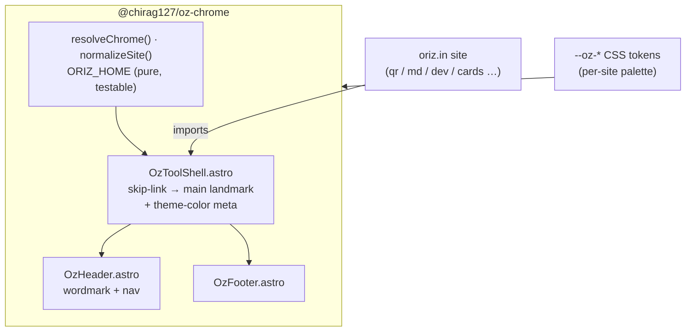

# @chirag127/oz-chrome

> Shared Astro chrome for oriz.in sites — one wordmark, header, footer, and an accessible tool-page shell. Restyle the whole fleet by editing this one package; each site keeps its palette via `--oz-*` tokens.

[](https://www.npmjs.com/package/@chirag127/oz-chrome)
[](LICENSE)
[](https://github.com/chirag127/oz-chrome/stargazers)
[](https://github.com/chirag127/oz-chrome/commits)

**npm:** https://www.npmjs.com/package/@chirag127/oz-chrome · **GHP landing:** https://chirag127.github.io/oz-chrome/ · **Repo:** https://github.com/chirag127/oz-chrome

If this is useful, please ⭐ [star the repo](https://github.com/chirag127/oz-chrome) — it helps others find it.

## Architecture



## Features

- **One shared chrome** — wordmark, header, footer, and a full tool-page shell for every oriz.in site.
- **Accessible by default** — `OzToolShell` renders a skip-link into a `<main id="oz-main">` landmark plus a `theme-color` meta.
- **Themed, not fixed** — ships no hard-coded look; all styling reads `--oz-*` tokens, so each site keeps its own palette.
- **Composable** — use the whole shell or drop in `OzHeader` / `OzFooter` individually.
- **Pure runtime helpers** — `resolveChrome`, `normalizeSite`, `ORIZ_HOME` are DOM-free and unit-tested.

## Tech stack

- **Astro** components (`.astro`), peer dependency `astro >= 4`
- **TypeScript** runtime helpers, built with **tsup**
- **vitest** for the pure-helper tests
- Zero runtime dependencies of its own

## Repo structure

```
oz-chrome/
├── src/
│   ├── components/OzToolShell.astro   # skip-link + main landmark + header + footer
│   ├── components/OzHeader.astro      # wordmark + nav slot
│   ├── components/OzFooter.astro      # footer slot
│   ├── index.ts                       # ChromeMeta, resolveChrome, normalizeSite, ORIZ_HOME
│   ├── index.test.ts                  # vitest — pure helpers
│   └── styles.css                     # --oz-* token contract
├── tsup.config.ts                     # build config
└── package.json                       # exports .astro components + styles.css + root
```

## Install

```sh
npm i @chirag127/oz-chrome
```

## Usage

```astro
---
import OzToolShell from '@chirag127/oz-chrome/components/OzToolShell.astro'
import '@chirag127/oz-chrome/styles.css'
---
<html lang="en">
  <head><meta charset="utf-8" /><title>Cards · oriz.in</title></head>
  <body>
    <OzToolShell site="cards" title="Flashcards">
      <a slot="nav" href="/about">About</a>
      <!-- tool body -->
      <h1>Build a deck</h1>
      <a slot="footer" href="https://oriz.in">More tools</a>
    </OzToolShell>
  </body>
</html>
```

### Props (`ChromeMeta`)

| prop | default | notes |
|---|---|---|
| `site` | — | subdomain slug → `cards.oriz.in` wordmark tail |
| `title` | wordmark | tool title in header |
| `wordmarkHref` | `https://oriz.in` | wordmark link |
| `themeColor` | `var(--oz-accent)` | `theme-color` meta value |

Individual pieces: `@chirag127/oz-chrome/components/OzHeader.astro`, `.../OzFooter.astro`.

### Runtime helpers

```ts
import { resolveChrome, normalizeSite, ORIZ_HOME } from '@chirag127/oz-chrome'

normalizeSite('Cards')          // → 'cards' (validated slug, '' if invalid)
resolveChrome({ site: 'cards' }) // → { wordmark: 'cards.oriz.in', title, themeColor, … }
ORIZ_HOME                        // → 'https://oriz.in'
```

## Theme per site

Ships no fixed look. Override `--oz-*` in your layout and the chrome inherits it:

```css
:root {
  --oz-accent: #7c3aed;
  --oz-font-display: 'Fraunces', serif;
}
```

## Configuration

No configuration required — no env vars. Behaviour is driven entirely by component props (`ChromeMeta`) and `--oz-*` CSS tokens.

## Part of the oriz family

`oz-chrome` is the shared shell behind the [oriz](https://blog.oriz.in) family — ~80 small tools, all running **$0 on the Cloudflare free tier**. It pairs with sibling packages like [`@chirag127/oz-file`](https://www.npmjs.com/package/@chirag127/oz-file) (zero-dep browser file helpers), and dresses hubs and tools such as [oriz-home](https://oriz.in).

## Contributing

Issues and PRs welcome. Keep the package token-driven and dependency-free; add a vitest case for any new pure helper. Conventional commits are the changelog.

## Status

Published on npm and used across the oriz fleet.

## License

MIT © Chirag Singhal — chirag@oriz.in
